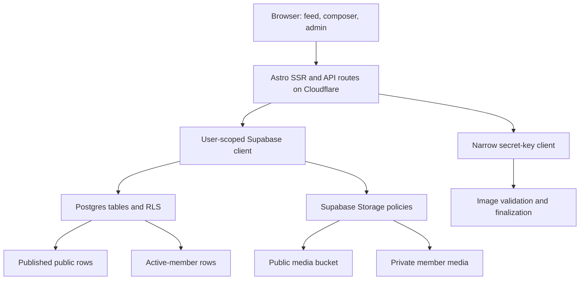

# Growth Circuit Community Feed - Plan

## Goal Capsule

- **Objective:** Ship a web-first Growth Circuit community where verified contributors can publish practical build posts and approved members can also use a private feed.
- **Product authority:** The Product Contract and its session-settled decisions govern user behavior. The Planning Contract governs implementation within those boundaries.
- **Execution profile:** Deliver one production-ready pull request, merge after required checks pass, apply the database and storage changes before the application depends on them, then verify production across anonymous, contributor, member, and admin roles.
- **Stop conditions:** Stop for a required product-scope change, evidence that private content can leak, unavailable production Supabase authority, or inability to identify Nick and Lucy's verified Auth users for admin bootstrap.
- **Tail ownership:** The implementation owner carries schema rollout, application deployment, admin bootstrap, and production privacy checks through completion.

---

## Product Contract

### Summary

Growth Circuit will expose one streamlined Reddit-like feed with Public and Members tabs.
Anyone may read public posts.
People who verify an email address and provide a first and last name may publish public posts, reply, and vote.
Approved members may also read and publish member-only posts.
Posts use one flexible prompted-Markdown composer with optional images and an optional GitHub repository link.

### Problem Frame

Growth Circuit has no current place for members or the wider marketing community to share what they are building and discuss practical ideas.
The earlier Buzz-fed concept adds an app-install and onboarding step before someone can contribute.
The repository already contains a dormant forum scaffold, but its browser-only authentication and public-only row policies cannot safely support private member content.

### Actors

- A1. **Anonymous reader:** Reads public posts without an account.
- A2. **Verified contributor:** Has completed passwordless email verification and a required first and last name. May create public posts, reply to public posts, and vote on public posts.
- A3. **Active member:** Has been approved by an admin. Receives all contributor capabilities plus member-feed read and write access.
- A4. **Admin:** Nick Lafferty or Lucy Hoyle. May grant, suspend, restore, or revoke membership and hide or restore posts and replies. Admin status is bootstrapped outside ordinary product controls.

### Key Decisions

- **Web-first participation** (session-settled: user-directed - chosen over a Buzz-fed app experience: requiring another application would add too much contribution friction). Governs R1, R2.
- **One shared feed with Public and Members tabs** (session-settled: user-directed - chosen over separate community spaces and a profile-home navigation model: the shared feed was the most streamlined direction). Governs R3, R4.
- **Verified email with real-name fields** (session-settled: user-approved - chosen over anonymous posting and password-based signup: passwordless verification keeps the first contribution low-friction while tying it to a first and last name). Governs R2, R5.
- **Supabase as the community backend** (session-settled: user-approved - chosen over introducing another backend: the repository already contains Supabase Auth, schema, and client scaffolding). Governs R2-R14.
- **Admin-controlled membership** (session-settled: user-directed - chosen over member-granted access: only Nick and Lucy should control the private member boundary). Governs R4, R6, R14.
- **One flexible post type** (session-settled: user-directed - chosen over separate text, image, question, and build post types: one model keeps the composer simple). Governs R7-R11.
- **Prompted Markdown composer** (session-settled: user-directed - chosen over a blank Markdown canvas and a metadata-heavy build checklist: optional prompts improve post quality without adding required fields). Governs R7, R8.

### Requirements

**Access and identity**

- R1. The community is available on the Growth Circuit website without an app install.
- R2. A new contributor must provide first name, last name, and email, then complete a passwordless email-link confirmation before posting.
- R3. The community home presents Public and Members as tabs within one feed experience.
- R4. Anonymous readers and non-member contributors cannot discover member-only post content, existence, author, metadata, or media.
- R5. Public posts are readable by anyone, while publishing, replying, and voting require a verified contributor identity.
- R6. Only active members and admins may read or write Members content.

**Posts and conversation**

- R7. A post has one product type with a title, prompted GFM-compatible Markdown body, audience, author, publication state, and timestamps.
- R8. The composer offers optional prompts for what was built, how it works, what broke, and what the author learned without storing them as required structured fields.
- R9. A post may include up to five JPEG, PNG, or WebP images of at most 5 MiB each.
- R10. The first ready image becomes the header by default, and the author may select another image or disable the header before publication.
- R11. A post may include one canonical public GitHub repository URL rendered as a useful repository card even when metadata is unavailable.
- R12. Verified contributors may reply to and toggle one upvote on public posts. Active members may do the same on member-only posts.

**Administration and safety**

- R13. Authors may edit or soft-delete their own content but cannot change ownership, moderation state, scores, or a published post's audience.
- R14. Nick and Lucy can grant, suspend, restore, or revoke membership and hide or restore posts and replies through audited admin flows. No product flow can grant admin status.
- R15. The service rate-limits post creation, enforces bounded upload quotas, and rejects unsafe Markdown, invalid repository URLs, invalid media, duplicate publication attempts, and unauthorized operations.

**Public discovery and privacy**

- R16. Published public posts render as crawlable server HTML with canonical metadata and sanitized excerpts.
- R17. RSS, sitemap, structured data, social metadata, related content, hydration data, logs, and caches exclude all member-only content.
- R18. Unauthorized requests for member-only posts return a generic no-store response without content-derived metadata.

### Key Flows

- F1. **Join and publish publicly**
  - **Trigger:** An anonymous visitor chooses to create a post.
  - **Actors:** A1, A2
  - **Steps:** The visitor provides first name, last name, and email; opens the email link; explicitly confirms sign-in; returns to the intended community route; completes a public post; publishes it.
  - **Outcome:** The public post appears in the feed and has a crawlable detail URL.
  - **Covered by:** R2, R5, R7-R12, R16.
- F2. **Use the private member feed**
  - **Trigger:** A signed-in contributor selects Members.
  - **Actors:** A2, A3
  - **Steps:** The service checks current membership; a contributor sees access guidance without post data; an active member receives the member query and may create a member-only draft.
  - **Outcome:** Member content is available only to an active member session and is never preloaded into the public feed.
  - **Covered by:** R3, R4, R6, R17, R18.
- F3. **Create a post with media**
  - **Trigger:** A contributor or member begins a draft and chooses its audience.
  - **Actors:** A2, A3
  - **Steps:** The system creates an owned draft; uploads enter the audience-matched staging path; each image is validated and finalized; the first ready image becomes the header; the author may reorder, replace the header, or disable it; publication completes once through an idempotent operation.
  - **Outcome:** The post and every referenced image share the same access boundary.
  - **Covered by:** R7-R11, R13, R15.
- F4. **Manage membership**
  - **Trigger:** Nick or Lucy opens the membership administration page.
  - **Actors:** A4
  - **Steps:** The server verifies the current admin row; the admin grants or changes membership; one transaction writes the new membership and its audit record.
  - **Outcome:** The authorization change affects the next private request without waiting for token refresh.
  - **Covered by:** R6, R14, R18.

### Acceptance Examples

- AE1. **Public contribution**
  - **Covers:** F1 / R2, R5, R7, R16
  - **Given:** A visitor has not signed in.
  - **When:** They verify their email link, complete first and last name, and publish valid Markdown.
  - **Then:** The post appears publicly under that name and renders as crawlable sanitized HTML.
- AE2. **Private denial without leakage**
  - **Covers:** F2 / R4, R17, R18
  - **Given:** A member-only post exists.
  - **When:** An anonymous reader or ordinary contributor requests its direct URL or media URL.
  - **Then:** The response reveals no title, author, excerpt, image, metadata, or existence signal and is not shared-cacheable.
- AE3. **Header selection**
  - **Covers:** F3 / R9, R10
  - **Given:** A draft contains three ready images.
  - **When:** The author selects the second image, deletes it, and disables the header.
  - **Then:** The selected pointer clears safely, all remaining body images still render, and the published feed card has no header.
- AE4. **Contributor blocked from Members publishing**
  - **Covers:** F2 / R6
  - **Given:** A verified contributor is not an active member.
  - **When:** They submit a Members draft or call the underlying database API directly.
  - **Then:** The write is denied and no member-only row or object is created.
- AE5. **Immediate membership revocation**
  - **Covers:** F4 / R6, R14, R18
  - **Given:** An active member has an existing session.
  - **When:** Nick or Lucy revokes membership.
  - **Then:** The next member-feed, detail, reply, vote, and image request is denied without requiring the session to refresh.

### Success Criteria

- A first-time contributor can move from email entry to a published text-only post without creating a password or choosing a post type.
- A public post with Markdown, images, a selected header, a GitHub link, replies, and votes works on desktop and mobile.
- Direct database, page, API, media, RSS, sitemap, and metadata checks prove that a non-member receives no member-only content.
- Nick and Lucy can independently change membership and every change produces an immutable audit record.
- The merged production deployment serves the community route, completes a real public post flow, and passes anonymous, contributor, member, and admin smoke checks.

### Scope Boundaries

**In scope**

- Public and member feeds, detail pages, replies, toggle upvotes, author edits, soft deletion, and membership administration.
- Passwordless email-link authentication, required name onboarding, Supabase Postgres/Auth/Storage, and server-side sessions.
- GFM-compatible Markdown without raw embedded HTML, five raster images, header selection, and one validated GitHub repository link.
- Public SEO/RSS/sitemap behavior and private-content exclusion.

**Deferred to follow-up work**

- Rich GitHub API metadata, digests, notifications, follows, tags, challenges, saved posts, search, post revisions, image moderation, malware scanning, responsive image derivatives, and automated orphan cleanup beyond a basic expiry path.
- A deliberate Astro 7 upgrade, custom SMTP migration unless the readiness probe makes it launch-blocking, multi-route rate-limit infrastructure beyond the MVP post and upload controls, and a GitHub App.

**Outside this product's identity**

- Buzz as a required contribution client.
- Anonymous posting, multiple public personas, user-selected post types, or user-granted membership.
- Arbitrary HTML, remote Markdown images, arbitrary URL previews, SVG uploads, and published public-to-private audience changes.

### Dependencies

- The existing Supabase project must accept versioned migrations, new Storage buckets, Auth callback URLs, and one server secret key.
- Nick and Lucy must each complete passwordless sign-in before their exact Auth user IDs can be inserted into the admin bootstrap table.
- Production email delivery must remain within Supabase limits for the initial community size; custom SMTP becomes a launch blocker if live delivery proves unreliable.

---

## Planning Contract

### Product Contract Preservation

The plan was bootstrapped from the conversation and `docs/growth-circuit-forum-plan.md`.
The session-settled direction is preserved.

### Key Technical Decisions

- KTD1. **Pin the current framework baseline before adding dependencies.** Keep Astro 6.4.8, `@astrojs/cloudflare` 13.7.0, `@astrojs/react` 5.0.7, React 19.2.7, and Supabase JS 2.108.2 exact for this feature. Add exact versions of `@supabase/ssr`, the unified Markdown pipeline, and the test tools. A major Astro upgrade is separate because the repository currently declares `latest` and an install could widen the change unexpectedly.
- KTD2. **Use cookie-backed Supabase SSR clients.** Use a publishable-key user-scoped client for ordinary requests and validate protected operations with current server identity. Reserve the Supabase secret-key client for narrow system operations. (session-settled: user-approved - chosen over password-backed or browser-only authentication: a passwordless verified-email flow keeps contribution friction low while SSR cookies make private routes enforceable). Covers R2-R6, R14, R18.
- KTD3. **Use an explicit-confirmation magic-link flow.** The link GET shows a confirmation screen and performs no token exchange until the user acts, which reduces enterprise email-scanner consumption while preserving the approved passwordless-link experience. Keep the flow OTP-compatible if production email behavior requires a later switch. Covers R2.
- KTD4. **Make Supabase RLS and Storage policies the authorization boundary.** Store current membership in database rows and evaluate it on every private operation. UI tabs and Worker checks provide earlier feedback but cannot authorize. Covers R4-R6, R12-R15, R17, R18.
- KTD5. **Create dedicated community tables beside the dormant forum scaffold.** Add `community_profiles`, memberships, admins, community posts, images, replies, votes, moderation audit, and membership audit data through versioned migrations. `community_profiles` links to `auth.users` and coexists with the existing `public.profiles` table, which is not redefined. Revoke product-role access to the dormant forum tables and redirect their routes into `/community`.
- KTD6. **Lock audience before the first image upload and after publication.** A draft selects `public` or `members`; uploads use the matching storage path; publication makes audience immutable. This avoids a public-to-private move that cannot recall cached or downloaded media. Covers R4, R6, R9, R10, R13, R17.
- KTD7. **Use separate public and private media buckets with a private staging lifecycle.** Store originals in private staging, validate one bounded object at a time, and finalize into an audience-specific bucket. Public derivatives receive stable URLs. Member media is served through an authorized same-origin route and never embedded as a reusable signed URL. Covers R4, R9, R10, R15, R17, R18.
- KTD8. **Render one sanitized Markdown pipeline for preview and publication.** Store source Markdown, support GFM, reject raw HTML and remote Markdown images, sanitize output, and annotate external links with `ugc`, `nofollow`, `noopener`, and `noreferrer`. Covers R7, R8, R15-R18.
- KTD9. **Treat GitHub as a validated link in the MVP.** Accept only canonical HTTPS repository URLs and render a durable card from the normalized owner and repository. Do not make publication depend on GitHub API availability. Covers R11, R15.
- KTD10. **Use server-rendered dynamic community routes with conservative caching.** Public pages are crawlable. All dynamic community HTML starts with shared caching disabled. Member responses are private and no-store, and unauthorized member slugs return generic no-content responses. Covers R4, R16-R18.
- KTD11. **Mutate membership and counters through atomic database functions.** Membership functions verify admin status and append an audit row in the same transaction. Vote and reply functions enforce parent visibility and update counts without allowing authors to tamper with score fields. Covers R12-R15.
- KTD12. **Protect every cookie-authenticated mutation against cross-site requests.** Unsafe methods must pass same-origin checks, Fetch Metadata checks with a defined legacy fallback, and a session-bound CSRF token or required custom header. Cookie-authenticated APIs reject credentialed cross-origin CORS, GET mutations, and stale admin sessions. Auth cookies are host-only, Secure, HttpOnly, and SameSite, with session rotation after authentication. Covers R2, R5, R6, R12-R15.
- KTD13. **Treat the secret-key media client as a confused-deputy boundary.** Construct it separately from request cookies and accept only server-generated identifiers. Before every privileged action, re-read the authenticated user, draft ownership, audience, membership, upload state, limits, and destination from trusted rows. Never accept a client-supplied bucket or object path. Covers R4, R6, R9, R10, R15, R17, R18.
- KTD14. **Use deny-by-default database grants in addition to RLS.** Define a role/object matrix for tables, columns, views, functions, sequences, and Storage. Revoke default function execution, prefer invoker functions, and justify each definer function with a fixed empty search path, fully qualified relations, and actor identity derived from `auth.uid()`. Covers R4-R6, R12-R15, R17, R18.
- KTD15. **Apply one explicit private-response cache contract.** Member, auth, admin, private-media, and generic unauthorized responses are no-store at browser and Cloudflare layers for GET, HEAD, Range, conditional requests, redirects, and errors. Authenticated community entrypoints bypass Worker caching. Covers R4, R17, R18.
- KTD16. **Dark-launch behind application and database-owned feature gates.** Every community write policy, RPC, and Storage upload policy checks a database launch state so direct Supabase access stays closed. The Worker serves dark routes only to a bounded rollout allowlist after both admins are bootstrapped; all other traffic receives the generic no-store response. After the allowlisted role and cache matrix passes, one audited database flip enables the public surface. A kill switch disables writes and private reads without deleting data. Covers R1-R18.
- KTD17. **Use Postgres counters for the MVP limiter.** Atomic database functions enforce a conservative per-user post-creation window, while U6 enforces upload object, byte, signing, and decode quotas. Broader IP, email, and multi-route abuse infrastructure remains deferred. Covers R15.
- KTD18. **Use random-bearing slugs.** Slugs combine a readable title fragment with a server-generated random component and never derive collision suffixes from another post, so member-post existence cannot influence public URLs. Covers R4, R7, R15, R18.
- KTD19. **Self-host the community surface.** Use the existing site and Supabase stack instead of a hosted forum so public posts remain crawlable on the Growth Circuit domain, the shared-feed visual identity stays owned, and private membership integrates with the existing site. This accepts a larger maintenance surface than Discourse or Circle.

### High-Level Technical Design

### System-Wide Impact

- **Request lifecycle:** Middleware owns session refresh, CSRF and origin checks, feature-gate evaluation, and generic no-store denial before protected routes render or query private data.
- **Direct data access:** RLS, explicit grants, Storage policies, and narrowly granted RPCs must independently enforce the actor matrix when requests bypass the Astro application.
- **Rendering and discovery:** Server Markdown output, previews, cards, metadata, hydration, RSS, sitemap, redirects, and error pages share one sanitization and audience-filtering contract. A private identifier cannot enter a public URL, cache key, analytics event, CSP report, or referrer.
- **Media lifecycle:** Staging objects are never directly readable. Finalization safely decodes and re-encodes raster images, strips metadata, generates the MIME type and name, and makes only finalized ready objects publishable. Storage and database transitions are idempotent and fail closed on partial completion.
- **Logging and failures:** Structured logs allowlist fields and redact bodies, tokens, emails, private slugs, signed URLs, and object paths. Supabase, membership, media, or cache uncertainty denies private and admin access with a generic no-store response.
- **Security headers:** Community responses use a restrictive CSP, HSTS, `X-Content-Type-Options: nosniff`, strict referrer policy, clickjacking protection, and minimal connection/image origins. Auth confirmation loads no third-party resources and uses `Referrer-Policy: no-referrer`.

### Assumptions

- First and last name fields create accountable display identities but do not independently prove legal identity.
- Magic-link delivery is sufficient for the initial community size. The confirmation interstitial mitigates link scanners, while production smoke testing decides whether OTP or custom SMTP is required.
- The MVP accepts up to five JPEG, PNG, or WebP files per post, 5 MiB each. U1 measures Worker-runtime decode and re-encode headroom and sets the pixel ceiling no higher than the tested safe bound, starting at 12 megapixels.
- The initial feed uses cursor pagination ordered by publication time. Ranking algorithms and separate Hot/New views are deferred.
- Existing dormant `/questions`, `/builds`, `/challenges`, and `/submit` routes redirect into the canonical `/community` experience.
- Membership states are `none`, `active`, `suspended`, and `revoked`. Grant moves `none` or `revoked` to `active`; suspend moves `active` to `suspended`; restore moves `suspended` to `active`; revoke moves `active` or `suspended` to `revoked`. Suspended and revoked users lose all member reads and writes, including their own member drafts and posts, while content remains available to other active members unless moderated.
- Email is retained only in Supabase Auth. `community_profiles` stores required display names and timestamps; public projections expose only the author's display name. The admin RPC returns the minimum identity fields needed to match a verified contributor.

### Risks and Dependencies

- **Private-content leakage:** A permissive RLS, Storage, caching, metadata, or hydration path could expose member content. Mitigate with database policy tests, negative integration tests, and active-member-to-anonymous request sequences.
- **Schema rollout drift:** The repository has one manually run `supabase/schema.sql` and no migration workflow. Add a versioned migration, keep the fresh-install schema synchronized, and verify production state before application deployment.
- **Auth library churn:** `@supabase/ssr` remains beta. Pin its exact version and keep project-owned wrappers around its cookie API.
- **Image validation on Workers:** Workers have bounded memory. Reject over-limit objects before download and validate one file at a time without buffering multiple uploads.
- **Admin bootstrap:** Admin rows cannot be safely inferred from names or user metadata. Production completion requires Nick and Lucy's verified Auth UUIDs after sign-in.
- **Dependency drift:** Exact pins avoid pulling Astro 7 or newer Supabase behavior during this feature.
- **Cross-site mutation and login attacks:** Ambient auth cookies make every mutation and auth exchange a CSRF target. Central middleware and handler tests enforce KTD12, including cross-site forms, cross-origin fetches, forged headers, and GET attempts.
- **Privileged-client escalation:** The media finalizer bypasses RLS. KTD13 requires reauthorization from trusted rows at every step, quotas, replay protection, transaction-safe state transitions, and bundle/log secret scans.
- **Abuse and resource exhaustion:** KTD17 owns the launch limits: a conservative per-user post-creation window plus U6 upload and finalization quotas. The limiter fails closed on unavailable database state. Broader email, IP, reply, vote, and admin limiting is deferred until traffic demonstrates the need.
- **Release-order conflict:** Merging to `main` immediately deploys Cloudflare. KTD16 and U9 require database-first production verification while the application remains dark, then an explicit enablement step after the merged version passes negative privacy checks.
- **Recovery limits:** Keep additive schema and buckets during rollback so old and new application versions remain compatible. Disable exposure first, restore the prior Cloudflare version second, and avoid destructive down migrations or object deletion during incident response. Public media already downloaded cannot be recalled.

### Sources and Research

- Existing product direction: `docs/growth-circuit-forum-plan.md`.
- Existing scaffolding: `src/components/AuthForm.tsx`, `src/components/ThreadComposer.tsx`, `src/components/ThreadCard.astro`, `src/lib/supabase.ts`, `src/lib/supabase-server.ts`, `supabase/schema.sql`.
- [Supabase Astro SSR quickstart](https://supabase.com/docs/guides/auth/quickstarts/astrojs).
- [Supabase passwordless email authentication](https://supabase.com/docs/guides/auth/auth-email-passwordless).
- [Supabase row-level security](https://supabase.com/docs/guides/database/postgres/row-level-security).
- [Supabase Storage access control](https://supabase.com/docs/guides/storage/security/access-control).
- [Supabase API key migration](https://supabase.com/docs/guides/getting-started/migrating-to-new-api-keys).
- [Cloudflare cache behavior](https://developers.cloudflare.com/workers/cache/configuration/).
- [OWASP file upload guidance](https://cheatsheetseries.owasp.org/cheatsheets/File_Upload_Cheat_Sheet.html).

### Sequencing

1. Verify production Supabase authority, recovery access, email delivery, callback behavior, and both admin identities through a minimal readiness probe.
2. Freeze dependencies, introduce the test harness, and prove Supabase SSR cookies on the Cloudflare runtime.
3. Apply the baseline and community migrations, database functions, RLS, and Storage policies.
4. Establish cookie-backed passwordless identity and profile completion.
5. Build the post, reply, vote, moderation, and membership services against RLS.
6. Add safe Markdown, GitHub links, and the prompted composer.
7. Add the audience-bound image lifecycle after Worker-limit measurement.
8. Build the shared feed, detail, member, and admin interfaces.
9. Prove privacy, deploy database changes, deploy the Worker dark, bootstrap admins, and verify production before enablement.

---

## Implementation Units

### U1. Verify readiness, freeze dependencies, and add verification foundations

- **Goal:** Make dependency installation deterministic and establish unit, database-policy, and browser-test entrypoints.
- **Requirements:** Supports R1-R18.
- **Dependencies:** None.
- **Files:** `package.json`, `package-lock.json`, `vitest.config.ts`, `playwright.config.ts`, `tests/e2e/community.spec.ts`, `.github/workflows/pr-build.yml`.
- **Approach:** First verify production Supabase authority, recovery access, configured email limits, callback behavior, real magic-link delivery, scanner behavior, and readiness to identify Nick and Lucy's Auth UUIDs. Pin the lockfile-resolved framework versions. Add exact community, Markdown, SSR, Vitest, and Playwright dependencies. Add scripts for unit tests, database-policy tests, browser tests, and the existing Astro build. Prove a minimal cookie persistence, refresh, confirmation, current-user, logout, and protected-route denial slice on the Cloudflare runtime before U2.
- **Execution note:** Prove the harness with one failing characterization or contract test before feature implementation, then keep the build green as units land.
- **Patterns to follow:** Node 22 in `.github/workflows/pr-build.yml` and `.github/workflows/deploy-production.yml`; current `npm ci` workflow.
- **Test scenarios:**
  - A clean `npm ci` uses Astro 6 and does not resolve Astro 7.
  - A minimal unit test runs in the repository's Node 22 environment.
  - The browser test starts the Astro Worker preview and loads an existing route.
- **Verification:** Dependency versions are exact, the new test commands start successfully, and `npm run build` still passes.

### U2. Add the community schema and authorization boundary

- **Goal:** Create durable community data, role transitions, atomic mutations, Storage buckets, and deny-by-default policies.
- **Requirements:** R3-R6, R9-R15, R17, R18; A1-A4; F2-F4.
- **Dependencies:** U1.
- **Files:** `supabase/migrations/20260816_existing_schema_baseline.sql`, `supabase/migrations/20260816_community_foundation.sql`, `supabase/schema.sql`, `supabase/config.toml`, `supabase/tests/community_rls.sql`, `src/types/community.ts`.
- **Approach:** Reconcile and checksum the accepted production baseline so fresh reset replays existing objects before the community migration. Add `community_profiles`, admins, memberships, posts, images, replies, votes, immutable membership and moderation audits, and a database launch-state row. Add fixed-search-path authorization helpers, random-bearing slug generation, and atomic publish, reply, vote, membership, moderation, rate-limit, and header-selection functions. Every write policy, RPC, and upload policy checks the launch state. Revoke product-role access to dormant forum tables.
- **Patterns to follow:** Existing UUID ownership in `supabase/schema.sql`; Supabase RLS guidance cited in KTD4.
- **Test scenarios:**
  - Anonymous can select a published public post and cannot select any member post, reply, vote, image record, or object.
  - A contributor can create a public draft as self and cannot create a member draft or change protected fields.
  - An active member can read and create member content, while suspended and revoked members cannot.
  - A non-admin cannot mutate membership or audit rows through tables or functions.
  - Nick or Lucy's bootstrapped admin row can change membership and creates one immutable audit record.
  - A reply inherits parent audience, one user has at most one upvote, and counters cannot be assigned directly.
  - Image records cannot point across posts or audiences, and only one enabled header pointer is active.
  - Direct Data API, RPC, and Storage writes fail while the database launch state is dark and succeed only after the audited enablement flip.
  - A public post with the same title as a member post receives an unrelated random-bearing slug.
- **Verification:** A fresh local database replays the migration, pgTAP policy tests pass for every actor, and direct Data API attempts cannot bypass the rules.

### U3. Replace browser-only auth with passwordless SSR identity

- **Goal:** Provide low-friction verified identity that protected Astro routes can trust.
- **Requirements:** R2-R6, R14, R18; F1, F2; AE1, AE2, AE4, AE5.
- **Dependencies:** U1, U2.
- **Files:** `src/lib/supabase.ts`, `src/lib/supabase-server.ts`, `src/lib/supabase-config.ts`, `src/lib/community-auth.ts`, `src/middleware.ts`, `src/components/AuthForm.tsx`, `src/components/AuthCallback.tsx`, `src/components/AuthBar.tsx`, `src/pages/auth.astro`, `src/pages/auth/callback.astro`, `src/pages/auth/confirm.astro`, `src/env.d.ts`, `worker-configuration.d.ts`, `wrangler.jsonc`, `.env.example`, `src/lib/community-auth.test.ts`, `tests/e2e/community.spec.ts`.
- **Approach:** Wrap exact-version `@supabase/ssr` browser and server clients. Collect first name, last name, and email for sign-up. Send a magic link whose GET lands on a confirmation interstitial. Exchange only after explicit action, preserve a validated internal return path, complete the profile, and expose contributor/member/admin state without trusting user metadata for authorization. Middleware owns the rollout allowlist, feature gate, kill switch, security headers, session refresh, and CSRF checks. Invalid, expired, used, or undelivered links render a recovery screen with resend, editable email, preserved safe return path, pending state, and success confirmation.
- **Patterns to follow:** Existing PKCE callback components and runtime config split in `src/lib/supabase*.ts`.
- **Test scenarios:**
  - A valid sign-up creates a verified user and constrained profile, then returns to the requested internal community route.
  - Missing or whitespace-only first or last name is rejected before posting.
  - A normal sign-in does not create an unknown account silently.
  - External, protocol-relative, encoded, and malformed return paths resolve to `/community`.
  - A scanner-style GET to the confirmation route does not consume the token.
  - Forged, expired, and replayed auth values do not create a trusted server session.
  - Suspended membership is reflected on the next protected request despite an existing session.
  - Cross-site forms, cross-origin fetches, absent or forged CSRF headers, GET mutations, login CSRF, and admin CSRF are rejected.
  - Auth responses and confirmation URLs are no-store, reveal no token through logs or referrers, and rotate the session after authentication.
  - Dark routes are available only to rollout-admin sessions; the kill switch blocks writes and private reads while leaving stored data intact.
  - Public, member, auth, admin, API, and media responses emit their exact security-header contract in Worker-runtime and production tests.
- **Verification:** SSR pages can distinguish A1-A4 using current server validation, cookies carry secure production attributes, and no service secret enters client output.

### U4. Implement community services, posts, replies, and votes

- **Goal:** Expose RLS-preserving operations for the shared feed and its conversations.
- **Requirements:** R3-R7, R11-R18; F1-F4.
- **Dependencies:** U2, U3.
- **Files:** `src/lib/community.ts`, `src/lib/community-server.ts`, `src/lib/community-rate-limit.ts`, `src/pages/api/community/feed.ts`, `src/pages/api/community/posts/index.ts`, `src/pages/api/community/posts/[id].ts`, `src/pages/api/community/posts/[id]/publish.ts`, `src/pages/api/community/posts/[id]/replies.ts`, `src/pages/api/community/posts/[id]/vote.ts`, `src/pages/api/community/posts.test.ts`, `src/lib/community.test.ts`.
- **Approach:** Use user-scoped Supabase clients for ordinary reads and writes. Provide separate public and member queries behind one UI model, cursor pagination, owned drafts, random-bearing slugs, idempotent publication, soft deletion, replies that inherit audience, and toggle upvotes through atomic functions. Enforce KTD17 before draft publication and return normalized JSON errors without content leakage.
- **Patterns to follow:** Response normalization in `src/pages/api/applications.ts` and `src/pages/api/waitlist.ts`.
- **Test scenarios:**
  - Public feed works without a session and never receives member rows.
  - Members feed returns sign-in or access guidance for A1/A2 and data only for A3/A4.
  - Duplicate publish requests create one published post and one stable slug.
  - Reply and vote operations enforce the parent post's audience after membership revocation.
  - Authors can edit allowed fields and cannot change author, audience, counts, or moderation state.
  - A soft-deleted or hidden post leaves no public detail, RSS, sitemap, or feed output.
- **Verification:** API tests cover authorization and failure responses, and all writes succeed with a user-scoped client under RLS.

### U5. Add safe prompted Markdown and GitHub repository links

- **Goal:** Build the selected prompted Markdown writing experience and one safe rendering pipeline.
- **Requirements:** R7, R8, R11, R15-R18; AE1.
- **Dependencies:** U1, U4.
- **Files:** `src/lib/community-markdown.ts`, `src/lib/community-github.ts`, `src/components/community/MarkdownEditor.tsx`, `src/components/community/GitHubRepoField.tsx`, `src/components/community/PostComposer.tsx`, `src/lib/community-markdown.test.ts`, `src/lib/community-github.test.ts`.
- **Approach:** Store Markdown source. Offer optional prompt insertions in one editor. Render preview and final output through the same GFM and sanitization pipeline. Reject raw HTML, remote Markdown images, unsafe protocols, and non-canonical GitHub URLs. Render a normalized repository card without requiring GitHub API data.
- **Patterns to follow:** React-island form state in `src/components/ThreadComposer.tsx`; KTD8 and KTD9.
- **Test scenarios:**
  - GFM headings, lists, tables, task lists, fenced code, emphasis, and local uploaded-image references render.
  - Raw HTML, event handlers, `javascript:`, `data:`, protocol-relative links, clobbering IDs, and remote images are removed or rejected.
  - External links receive the required `rel` values.
  - Preview output and published output are structurally identical for the same source.
  - Prompt insertion never becomes required schema and can be removed freely.
  - Canonical GitHub repository URLs normalize, while lookalike domains, credentials, ports, fragments, and non-repository paths fail safely.
- **Verification:** Unit tests include hostile Markdown and URL fixtures, and the composer publishes a text-only post without optional fields.

### U6. Implement image upload and header selection

- **Goal:** Support bounded multiple-image posts without crossing audience or ownership boundaries.
- **Requirements:** R9, R10, R13, R15, R17, R18; F3; AE2, AE3, AE4.
- **Dependencies:** U2, U4, U5.
- **Files:** `src/lib/community-storage.ts`, `src/components/community/ImageUploader.tsx`, `src/pages/api/community/uploads/sign.ts`, `src/pages/api/community/uploads/finalize.ts`, `src/pages/api/community/uploads/[id].ts`, `src/pages/api/community/media/[id].ts`, `src/lib/community-storage.test.ts`, `tests/e2e/community.spec.ts`, `wrangler.jsonc`, `.env.example`.
- **Approach:** Create a draft before upload. Generate immutable server-owned paths. Upload one object at a time to private staging. Enforce per-user byte, object, signing, and decode-cost limits; fully decode and safely re-encode allowed raster images; strip metadata; and finalize with a server-selected name and MIME type into the draft's audience bucket. Use explicit staging, validating, ready, failed, and deleted states so publication references only ready objects. Default the first ready image as header. Support reorder, select, delete, retry, and no-header states. Serve member media only through an authorized same-origin route. Store the Supabase server credential only as an encrypted Cloudflare secret binding; configuration files contain the binding name, never its value, and local or preview environments use separate non-production credentials.
- **Patterns to follow:** Worker runtime environment access in `src/lib/supabase-server.ts`; KTD6 and KTD7.
- **Test scenarios:**
  - Valid JPEG, PNG, and WebP files within limits finalize into the correct audience bucket.
  - SVG, GIF, wrong MIME, signature mismatch, oversized bytes, oversized dimensions, path traversal names, and cross-user finalization fail.
  - Partial upload failure preserves the draft and permits retry or removal.
  - The first ready image becomes header, selection can move, disabling clears it, and deleting the selected image leaves no broken reference.
  - Anonymous and contributor users cannot retrieve member media by object path, database ID, or stale application URL.
  - Public post markup never contains private bucket paths or signed member URLs.
  - Arbitrary paths, cross-user IDs, revoked membership during finalization, replay, concurrent finalization, deleted drafts, malformed decodes, polyglots, decompression bombs, trailing payloads, and quota races fail closed.
  - Finalization crashes and Storage/database divergence leave no reachable partial object and can be retried idempotently.
- **Verification:** Storage-policy tests and API tests prove ownership and audience isolation, while browser tests prove upload, preview, header swap, no-header, and publication.

### U7. Add audited membership administration

- **Goal:** Let Nick and Lucy manage private membership without exposing admin promotion.
- **Requirements:** R6, R14, R15, R18; F4; AE5.
- **Dependencies:** U2-U4.
- **Files:** `src/components/community/MembershipAdmin.tsx`, `src/pages/community/admin/members.astro`, `src/pages/api/community/admin/members/index.ts`, `src/pages/api/community/admin/members/[userId].ts`, `src/pages/api/community/admin/moderation/[contentId].ts`, `src/pages/api/community/admin/members.test.ts`, `supabase/bootstrap/admin_bootstrap.sql`, `supabase/tests/community_rls.sql`.
- **Approach:** List verified contributors and current membership without exposing private content. Route every membership and moderation transition through audited database functions. Keep admin bootstrap outside ordinary UI, require a recent current admin session for every action, and make repeated requests idempotent. Define plain-language consequences, confirmations, disabled pending controls, success feedback, and recovery for membership transitions. Non-members receive contact guidance for reaching Nick or Lucy; no self-grant or automatic approval exists. Use a reviewed one-shot bootstrap script that accepts exact verified Auth UUIDs, asserts exactly two final admin rows, and revokes its own authority.
- **Patterns to follow:** Server-only secret handling in `src/lib/supabase-server.ts`; KTD11.
- **Test scenarios:**
  - A non-admin cannot list the admin queue or call grant/revoke operations.
  - Nick and Lucy can independently grant, suspend, restore, and revoke a contributor.
  - Every successful transition records actor, target, old state, new state, timestamp, and request ID once.
  - Audit rows cannot be changed or deleted through the product roles.
  - Product requests cannot create, update, or delete admin rows.
  - Bootstrap verifies both intended verified emails against exact UUIDs, asserts exactly two admins, and removes the bootstrap authority immediately.
  - Stale, logged-out, and downgraded sessions cannot list contributor identity or change membership or moderation state.
  - Nick and Lucy can hide and restore posts and replies; every change records actor, target, reason, prior state, new state, timestamp, and request ID.
- **Verification:** Role-specific API and RLS tests pass, the admin route is noindex and no-store, and the production bootstrap procedure uses exact Auth UUIDs.

### U8. Build the shared feed, detail pages, and public discovery surfaces

- **Goal:** Turn the selected streamlined visual direction into the canonical community experience.
- **Requirements:** R1, R3-R18; F1-F3; AE1-AE5.
- **Dependencies:** U3-U7.
- **Files:** `src/pages/community/index.astro`, `src/pages/community/[slug].astro`, `src/pages/community/submit.astro`, `src/components/community/CommunityFeed.tsx`, `src/components/community/PostCard.astro`, `src/components/community/PostDetail.astro`, `src/components/community/ReplyComposer.tsx`, `src/components/community/VoteButton.tsx`, `src/styles/community.css`, `src/layouts/BaseLayout.astro`, `src/lib/seo.ts`, `src/pages/rss.xml.ts`, `src/pages/sitemap-community.xml.ts`, `src/pages/submit.astro`, `src/pages/questions/index.astro`, `src/pages/builds/index.astro`, `src/pages/challenges/index.astro`, `tests/e2e/community.spec.ts`.
- **Approach:** Present Public and Members tabs in one compact feed. Keep the composer immediately accessible. Reuse the vote-column/card rhythm and add restrained blue-module, status-light, and playful copy cues from the approved local visual exploration. Define loading, empty, access-guidance, recoverable-error, retry, pagination, and end-of-feed states. Authors receive discoverable edit and soft-delete actions with validation, confirmation, cancellation, success feedback, and a post-delete return to the active feed. Render public detail pages on the server. Resolve member posts only after authorization and exclude them from every discovery surface.
- **Patterns to follow:** `src/components/ThreadCard.astro`, `src/styles/global.css`, `src/styles/myspace.css`, `src/layouts/BaseLayout.astro`.
- **Test scenarios:**
  - Public feed and detail pages work logged out on desktop and mobile.
  - Members tab prompts A1 to sign in, gives A2 access guidance, and shows content only to A3/A4.
  - Switching tabs never preloads member rows into an unauthorized page or cache.
  - Public pages contain canonical metadata, safe HTML, stable public header images, and useful GitHub cards.
  - Member and unpublished slugs yield generic no-store responses with no title, author, excerpt, image, JSON-LD, or Open Graph values.
  - RSS and the community sitemap include only published public posts.
  - Legacy forum entry routes lead into the canonical community without recreating multiple post types.
  - Tabs, votes, image ordering, upload status, publication status, validation errors, and route changes have keyboard, screen-reader, focus, live-region, non-drag, and minimum-touch-target behavior.
- **Verification:** Browser tests pass across the role matrix, affected pages meet responsive and keyboard-accessibility checks, and direct response inspection finds no private content leakage.

### U9. Roll out Supabase and verify production

- **Goal:** Apply infrastructure and application changes in a reversible order and prove the live privacy boundary.
- **Requirements:** R1-R18 and every Acceptance Example.
- **Dependencies:** U1-U8.
- **Files:** `.github/workflows/pr-build.yml`, `.github/workflows/deploy-production.yml`, `README.md`, `supabase/migrations/20260816_existing_schema_baseline.sql`, `supabase/migrations/20260816_community_foundation.sql`, `supabase/bootstrap/admin_bootstrap.sql`, `supabase/tests/community_rls.sql`, `tests/e2e/community.spec.ts`.
- **Approach:** Record the production migration history, table/Auth-user counts, bucket visibility, redirects, admin rows, backup or recovery-point status, restoration authority, secret binding scope, and credential rotation procedure. Apply and verify the additive migration, grants, RLS, fixed-search-path functions, buckets, Storage policies, redirect URLs, and Worker bindings before merge while database writes remain dark. Deploy the Worker dark with auth routes available. Have Nick and Lucy complete production sign-in through the shipped flow, match each verified email to its exact Auth UUID twice, bootstrap exactly two admins, and remove the one-shot bootstrap authority. Use the bounded rollout allowlist to run the complete role and cache matrix, then perform one audited public enablement flip and repeat anonymous and contributor checks. Mark disposable test data so cleanup preserves immutable audits.
- **Execution note:** Any schema drift, missing authority, unexpected grant, email failure, secret exposure, private-content difference, shared-cache hit, or unexplained log output is no-go. Rollback disables the feature first and restores the prior Worker version while leaving additive database state intact.
- **Patterns to follow:** Existing production deployment and curl verification in `.github/workflows/deploy-production.yml`.
- **Test scenarios:**
  - Production migration is idempotent or records a clear already-applied state.
  - A real passwordless email reaches the recipient and returns to the intended production route.
  - A real public Markdown post with image and GitHub link renders and appears in RSS and sitemap.
  - Anonymous, contributor, member, suspended member, Nick, and Lucy receive the expected live permissions.
  - An active-member request followed by an anonymous request for the same post and media returns no cached private content.
  - Revocation removes private access on the next request.
  - Every new table has RLS enabled; expected policies, grants, owners, and fixed search paths exist; protected columns are not directly writable; audit rows are immutable; and bucket public flags match audience.
  - Member-warmed then anonymous, and anonymous-warmed then member, requests across GET, HEAD, Range, ETag, and modified-since variants reveal no private content and never hit a shared private cache.
  - The deployed Cloudflare version matches the merged commit, the feature gate enables only after all checks pass, and the kill switch restores a safe response without data deletion.
- **Verification:** The merged `main` deployment passes GitHub Actions, the exact deployed version is recorded, `https://growthcircuit.club/community` serves the enabled live feed, disposable content and orphaned objects are removed without deleting audit history, and checks at deploy, +1 hour, +4 hours, and +24 hours record no token, email, private body, private identifier, or signed URL.

---

## Verification Contract

| Gate | Applies to | Required evidence |
|---|---|---|
| `npm ci` | U1-U9 | Exact dependency graph installs on Node 22 without a major framework drift. |
| `npm run test` | U1, U3-U8 | Unit and handler tests pass, including hostile Markdown, auth, URL, media, and authorization fixtures. |
| `npm run test:db` | U2, U4, U6, U7, U9 | Supabase migration replay and pgTAP role/policy tests pass. |
| `npm run test:e2e` | U1, U3-U9 | Browser role matrix and composer/media flows pass against the Worker runtime. |
| `npm run build` | U1-U9 | Astro type checking and production build pass. |
| `git diff --check` | U1-U9 | No whitespace errors or accidental conflict markers remain. |
| PR checks | U9 | PR build and review checks pass on the final branch head. |
| Production smoke | U9 | Public post, private denial, role transitions, media isolation, RSS, sitemap, and deployment URL are verified live. |

### Production Go or No-Go

- **Go:** The migration version and checksum match; production role-policy checks pass directly through the Data API; expected grants, function ownership, fixed search paths, buckets, redirect URLs, secrets, recovery point, and exactly two verified admins are recorded; real email delivery works; the dark Worker passes the full privacy/cache matrix through the rollout allowlist; the audited database enablement flip succeeds.
- **No-go:** Any drift, missing binding, unexpected role capability, scanner-consumed or replayable email link, private response difference, cache hit, token or private identifier in output/logs, or inability to disable the surface.
- **Rollback:** Disable community writes and private reads, restore the prior Cloudflare version, purge any exposed cache entries, rotate affected credentials or URLs, keep additive database/storage state, and restore from the confirmed recovery point only if corruption occurred.

---

## Definition of Done

- R1-R18 and AE1-AE5 are implemented without a launch-blocking open question.
- U1-U9 satisfy their test scenarios and verification outcomes.
- Supabase migration, grants, RLS, functions, Storage policies, Auth redirects, and secret-key configuration are applied to production.
- Nick and Lucy's exact verified Auth UUIDs are bootstrapped as the only admin rows.
- Public, contributor, member, suspended-member, and admin production flows are verified.
- Private post content and media are absent from unauthorized database queries, direct URLs, HTML, metadata, hydration, RSS, sitemap, logs, and shared caches.
- The one shared feed and prompted Markdown composer match the approved streamlined visual direction on desktop and mobile.
- The final branch is simplified, reviewed, committed, pushed, merged, and deployed through the existing production workflow.
- Temporary users, posts, uploads, and local experimental code from abandoned approaches are removed.
- Immutable membership audit rows from production verification are retained and labeled; launch monitoring is checked at deploy, +1 hour, +4 hours, and +24 hours with Nick as rollback decision-maker.
