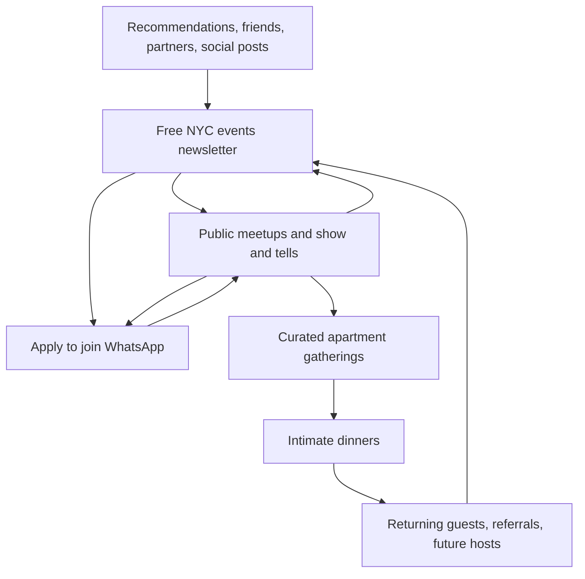

# Growth Circuit: newsletter, events, and a small business

Working proposal, September 18, 2026. Event integration is implemented separately; newsletter launch, pricing, cadence, and audience remain proposals.

## Recommendation

Use the existing Growth Circuit Luma calendar for events and the existing Growth Circuit Loops workspace for the newsletter. Keep the website as the front door and Notion as the identity and consent record. Start with a free weekly email and make the first business experiments around events and selective sponsorship.

Proposed reader promise: **Five NYC events worth leaving your apartment for, picked by Nick and Lucy.** Start with marketers, engineers, and people building things, with an occasional adjacent creative or social pick. This audience focus is a recommendation pending Nick's preference, not a settled positioning decision.

The scarce thing is a useful shortlist and good people in the room. A giant event directory gives readers more homework. Include other organizers' events even in weeks when Growth Circuit hosts nothing.

## The funnel

WhatsApp is optional. Nobody needs to enter a group to attend a public event or receive the newsletter. Attendance and useful participation help Nick and Lucy curate smaller gatherings. The dinner invitation is a human decision, not an automated reward for email engagement.

| Layer | Promise | First experiment | Measure |
| --- | --- | --- | --- |
| Newsletter | A short, opinionated shortlist that saves time | One email per week for six weeks, 5 picks, 2 minutes to read | Confirmed subscribers, event clicks, replies, unsubscribes |
| WhatsApp | Find someone to go with, ask questions, keep a conversation going | Approved NYC group, clear norms, one weekly event thread | Useful conversations and return attendance |
| Public events | An easy first meeting | One monthly 30–60-person meetup or show & tell | RSVPs, checked-in attendees, first-timers, repeat attendees |
| Apartment gatherings | A smaller room with a reason to be there | 12–20 people, subject and capacity chosen together | Show rate, cost per attendee, introductions that continue |
| Dinners | A carefully chosen table and deeper conversation | 6–10 guests, one theme, clear ticket price if needed | Repeat interest, contribution after costs and host time |

These capacities and cadences are starting proposals. Apartment capacity should follow the actual venue and hosts' comfort. Build gatherings around food, ideas, and conversation; include appealing nonalcoholic options.

## Newsletter format and signup

Start with email address only. Ask optional interests and neighborhood after signup. A welcome email delivers a sample issue and one next step: browse the calendar. Offer the WhatsApp application separately.

Each issue:

1. Two sentences from Nick or Lucy on what looks interesting this week.
2. Five picks for the next 7–14 days. Each has date/time, neighborhood or online, price, who it suits, and one honest sentence about why it made the cut.
3. A clearly marked Growth Circuit event when one is scheduled.
4. One reply prompt: “What should we check out next week?”

Confirm dates, availability, price, organizer, and RSVP link before each send. Mark sponsored placements clearly and keep paid inclusion separate from editorial judgment. Store a public issue archive on growthcircuit.club so issues can be shared and found later.

Create a dedicated newsletter preference and Loops list. Current live Loops lists were verified as NYC and Global; neither proves consent for a new weekly citywide newsletter. Preserve unsubscribes. Add a separate optional newsletter opt-in to Luma registration when launching the integration. Do not automatically enroll past Partiful guests or Luma registrants.

Future homepage primary CTA: **Get the NYC shortlist**. Secondary: **See upcoming events**. Until a working signup exists, the site should use the event CTA that is being shipped now.

## Event operating model

The existing calendar is https://luma.com/growth-circuit, calendar ID `cal-l48U97luvjJDet7`. Growth Circuit Show & Tell was verified on it on September 18.

Create all new Growth Circuit events under that calendar. Use public listings for open meetups. Keep private apartment gatherings and dinners unlisted with approval required, and show the address only to approved guests. These private-event settings are recommendations, not changes to any existing event.

The homepage and /events use Luma's supported live calendar embed. Public calendar changes appear without a website deploy. The direct calendar link remains visible if the embed does not load. Old Partiful events remain historical records. Before moving any future Partiful event, review existing registrations and the attendee communication plan to avoid competing RSVP pages.

Luma calls its formal multi-calendar company container an Organization and limits it to Enterprise. One shared calendar is sufficient for Growth Circuit's current needs.

## Platform choice and agent support

| Platform | Current evidence | Recommendation |
| --- | --- | --- |
| Loops | Existing Growth Circuit workspace verified; official CLI, Campaign API and LMX support drafts editable in its UI. Free up to 1,000 subscribed contacts and 4,000 total sends per rolling 30 days. | Start here. Build a simple archive and referral attribution on our own site if useful. |
| beehiiv | Newsletter-focused product; Create Post API is currently on Max and Enterprise. | Revisit if native newsletter growth and publishing tools become worth a second system and the required plan. |
| Substack | Official Developer API terms describe access to public creator/publication information. A supported draft/send workflow was not established in this research. | Poor fit for the API-first operation requested here. |
| Luma | Free shared calendar and live embed. Official MCP supports event discovery and management without Plus. Direct API requires Plus. | Event system. Keep newsletter editorial and subscriber consent in Loops/Notion. |

Luma's account UI quoted Plus at $69/month. Public annual pricing is $59/month billed annually. No upgrade was purchased. Use the free calendar embed now. Connect the official MCP at https://mcp.luma.com when authorizing agent account access. It can discover events, manage events, and work with guests; it has not been connected during this change.

Use Plus when a background service needs direct API access, such as reliably syncing registration/attendance into Notion or rendering a custom native event feed. Store the calendar-scoped key on the server. Publish only public event fields, never guest lists, private meeting links, or hidden addresses.

For the newsletter, an agent can research candidate events, deduplicate them, verify source details, and create a Loops draft. Nick or Lucy chooses the final list and approves the send. Automate the work of collecting details while keeping the taste and invitations human.

## Build the business slowly

First six weeks: prove a repeatable issue and one event format. Keep the newsletter free. Budget host time as a real cost. Record venue, food, supplies, payment fees, and time for each event.

Then test one revenue source at a time:

- Tickets that cover costs for small gatherings and dinners.
- A relevant sponsor underwriting a public event, with clear expectations and no automatic access to guest emails.
- A single clearly labeled newsletter placement once reader engagement and sponsor fit are understood.

Delay paid membership until people repeatedly ask for more access and the hosts can deliver the promised frequency. Attendance, return visits, and referrals matter more than open rate or raw list size.

Track each event's contribution as ticket revenue plus sponsorship minus direct costs, fees, and host time. No revenue projection is warranted before these inputs are observed.

## Next build

1. Agree the reader promise and weekly cadence.
2. Add a newsletter-specific preference to the existing Notion/Loops sync and a simple confirmed-email signup.
3. Create the welcome email and a reusable draft template; test suppression and unsubscribe behavior.
4. Produce two sample issues before announcing a schedule.
5. Publish the signup and archive, then switch the homepage primary CTA to the newsletter.
6. Run six weeks and one repeatable event. Review time spent, clicks, attendance, return visits, and contribution before adding more formats.

## Sources checked September 18, 2026

- Luma pricing: https://luma.com/pricing
- Luma API: https://docs.luma.com/reference/getting-started-with-your-api
- Luma MCP: https://help.luma.com/p/mcp
- Luma Organizations: https://help.luma.com/p/organizations
- Loops Campaign API and LMX: https://loops.so/changelog/content-api-goals
- Loops pricing: https://loops.so/pricing
- beehiiv Create Post: https://developers.beehiiv.com/api-reference/posts/create
- Substack Developer API scope: https://substack.com/api-tos
